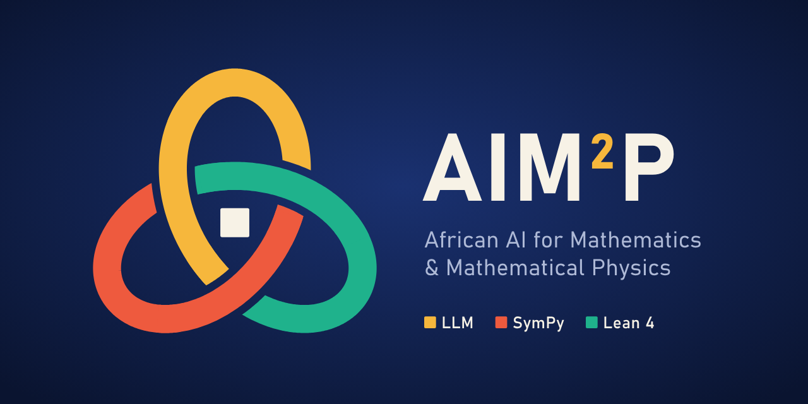
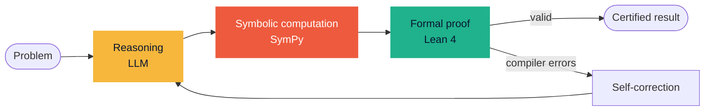

<p align="center">
  
</p>

<p align="center">
  <a href="LICENSE"></a>
  
  
</p>

# AIM²P research program

This repository holds the scientific foundations of **AIM²P** (African AI for Mathematics & Mathematical Physics): the research question, the state of the art, the research gap, the research proposal and the 2026–2028 roadmap.

**Website:** [aim2p.github.io/research](https://aim2p.github.io/research/), in French and English, with an interactive proof workshop and a Krylov complexity lab.

AIM²P asks whether AI can become a **rigorous, certified and self-correcting research assistant** for pure mathematics and theoretical physics. The approach couples three engines in one loop, so that no result is accepted before it is checked:



## Documents

The documents are written in French. Each one is available in Markdown (readable directly on GitHub) and as a PDF.

| # | Document | What it covers | Read |
|:-:|---|---|---|
| 0 | **Roadmap 2026–2028** | Vision, objectives, architecture, Krylov case study, 19-phase roadmap, first 90 days | [Markdown](docs/00_Roadmap_2026-2028.md) · [PDF](docs/pdf/00_Roadmap_2026-2028.pdf) |
| 1 | **Research Question** | Central question, sub-questions SQ1–SQ3, hypotheses H1–H3 | [Markdown](docs/01_Research_Question.md) · [PDF](docs/pdf/01_Research_Question.pdf) |
| 2 | **State of the Art** | LLMs, proof assistants, symbolic solvers, AI for physics, recent systems | [Markdown](docs/02_State_of_the_Art.md) · [PDF](docs/pdf/02_State_of_the_Art.pdf) |
| 3 | **Research Gap** | The four open problems AIM²P targets | [Markdown](docs/03_Research_Gap.md) · [PDF](docs/pdf/03_Research_Gap.pdf) |
| 4 | **Research Proposal v0.1** | Pre-registered hypotheses, AMP-Bench-mini, protocol, Krylov case study, timeline, budget | [Markdown](docs/04_Research_Proposal_v0.1.md) · [PDF](docs/pdf/04_Research_Proposal_v0.1.pdf) |
| 5 | **Domain Map** (phase P1) | Tool comparison and frozen choices: Lean 4.35, Mathlib, Physlib, SymPy, free models, verification chain | [Markdown](docs/05_Domain_Map.md) · [PDF](docs/pdf/05_Domain_Map.pdf) |

## Research question

> To what extent does an open neuro-symbolic loop, in which an LLM reasons, SymPy computes and critiques, and Lean 4 certifies, increase the share of correct and fully verified solutions, and reduce the share of unverified success claims, at equal compute budget, compared with the same LLM used alone or filtered by the same verifier, on problems in mathematics and mathematical physics (case study: finite-dimensional operator dynamics and Krylov complexity)?

**Hypotheses we will test** on AMP-Bench-mini, a 40-item benchmark frozen together with its grader before any run:

- **H1 (equal-budget gain):** the loop, capped at 5 revision rounds, beats the same LLM used alone in one attempt by at least 20 absolute percentage points of verified success (H1a), and also beats the same LLM given five independent attempts filtered by the same verifier, at comparable token budget (H1b). Both are judged on paired, problem-by-problem differences.
- **H2 (lemma certification curve):** for intermediate lemmas from a fixed proof plan, at least 70% are certified by the Lean kernel (standard axioms only, statement unchanged) within 5 compile → error → revision iterations. We publish the full success curve, compared with equal-cost resampling and broken down by Lean error type.
- **H3 (injected physics errors):** on correct mathematical-physics derivations with deliberately injected errors, we compare an LLM judge, step-by-step SymPy checks and Lean 4. Typing should reject dimensional and invariance errors (H3a); proof obligations should expose missing hypotheses, degenerate cases and wrong boundary conditions better than the other two critics (H3b); automatic correction is exploratory (H3c).

The hypotheses are pre-registered before any measurement; their decision criteria are fixed in the Research Proposal.

## Why mathematical physics

Formal verification has made fast progress on competition mathematics, but theoretical physics is still a small part of certified proof corpora, and Krylov complexity, the Lanczos recursion and operator growth are absent from the reference libraries (Mathlib, Physlib) as of November 2026. AIM²P's flagship case study is **Krylov complexity**: deriving the Krylov basis with a symbolic Lanczos algorithm, checking the regularity of the Lanczos coefficients *bₙ* and operator growth, and, where both sides have a closed form, comparing Krylov-space trajectories with holographic models.

## Roadmap at a glance

| Phases | Focus | Status |
|---|---|---|
| P0 | Scientific framing: question, state of the art, gap, research proposal | ✅ Done |
| P1 – P3 | Domain mapping, benchmark specification, baselines | ✅ P1 done · 🔄 P2 in progress |
| P4 – P6 | Reasoning engine, Lean 4 integration, compiler-guided self-correction | Planned |
| P7 – P8 | Mathematical physics module and AMP-Bench | Planned |
| P9 – P10 | Publications and open-source ecosystem | Planned |
| P11 – P16 | Team, advisory board, funding, collaborations, conferences, African research network | Planned |
| P17 – P18 | Scientific discovery and scaling | Planned |

## How we work

Rigor, reproducibility, open science, strict comparison against baselines, automatic verification and independence from any single LLM provider. One rule sums it up:

> We never write *"our AI solves mathematics"*. We write: *"our system reaches X% on AMP-Bench versus Y% for the baseline, with Z% of solutions fully verified by Lean 4."*

## Repository layout

```text
docs/        Research documents in Markdown (the source of truth)
docs/pdf/    PDF exports, rebuilt with tools/build_pdfs.py
web/         Public website (Astro), built from docs/ and branding/
bench/lean/  Pinned Lean 4 environment for AMP-Bench (Lean, Mathlib, Physlib v4.35.0)
branding/    AIM²P logo, banner and the script that generates them
tools/       Build scripts
```

## Get involved

Feedback is welcome, especially from mathematicians, physicists, AI researchers and Lean 4 developers.

- Did we miss important work in the state of the art? Please [open an issue](https://github.com/AIM2P/research/issues) with the reference.
- Questions, objections and ideas about the research question or the hypotheses are welcome in issues too.

## Citation

If you refer to this research program, please cite it using the metadata in [`CITATION.cff`](CITATION.cff) (GitHub's **Cite this repository** button generates APA and BibTeX for you).

## License

The documents in this repository are released under the [Creative Commons Attribution 4.0 International license](LICENSE) (CC BY 4.0). The AIM²P name and logo identify the initiative: please do not use them in a way that suggests endorsement.

---

### En français

Ce dépôt rassemble les documents fondateurs d'**AIM²P** (African AI for Mathematics & Mathematical Physics) : question de recherche, état de l'art, verrous scientifiques et roadmap 2026–2028. AIM²P évalue dans quelle mesure une boucle ouverte, où un LLM raisonne, SymPy calcule et critique, et Lean 4 certifie, augmente à budget de calcul égal la part de solutions correctes et intégralement vérifiées en mathématiques et en physique mathématique (cas d'étude : complexité de Krylov), par rapport au même LLM utilisé seul ou filtré par le même vérificateur. Les documents sont en français, dans le dossier [`docs/`](docs/). Retours et contributions bienvenus via les [issues](https://github.com/AIM2P/research/issues).
