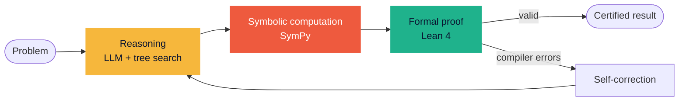

<p align="center">
  
</p>

<p align="center">
  <a href="LICENSE"></a>
  
  
</p>

# AIM²P research program

This repository holds the scientific foundations of **AIM²P** (African AI for Mathematics & Mathematical Physics): the research question, the state of the art, the research gap and the 2026–2028 roadmap.

AIM²P asks whether AI can become a **rigorous, certified and self-correcting research assistant** for pure mathematics and theoretical physics. The approach couples three engines in one loop, so that no result is accepted before it is checked:



## Documents

The documents are written in French. Each one is available in Markdown (readable directly on GitHub) and as a PDF.

| # | Document | What it covers | Read |
|:-:|---|---|---|
| 0 | **Roadmap 2026–2028** | Vision, objectives, architecture, Krylov case study, 19-phase roadmap, first 90 days | [Markdown](docs/00_Roadmap_2026-2028.md) · [PDF](docs/pdf/00_Roadmap_2026-2028.pdf) |
| 1 | **Research Question** | Central question, sub-questions SQ1–SQ3, hypotheses H1–H3 | [Markdown](docs/01_Research_Question.md) · [PDF](docs/pdf/01_Research_Question.pdf) |
| 2 | **State of the Art** | LLMs, proof assistants, symbolic solvers, AI for physics, recent systems | [Markdown](docs/02_State_of_the_Art.md) · [PDF](docs/pdf/02_State_of_the_Art.pdf) |
| 3 | **Research Gap** | The four open problems AIM²P targets | [Markdown](docs/03_Research_Gap.md) · [PDF](docs/pdf/03_Research_Gap.pdf) |

## Research question

> To what extent can an integrated neuro-symbolic architecture (LLM reasoning, SymPy symbolic computation and Lean 4 formal verification) guarantee rigorous, self-correcting and reproducible proofs in pure mathematics and theoretical physics, while driving the hallucination rate to zero?

**Hypotheses we will test:**

- **H1:** the LLM + SymPy + Lean 4 loop beats a state-of-the-art LLM used alone by more than 40% in accuracy on AMP-Bench, our planned benchmark.
- **H2:** self-correction guided by Lean compiler errors reaches a certified proof in fewer than 5 iterations for at least 70% of intermediate lemmas.
- **H3:** formal verification can detect and correct boundary-condition and invariance errors in complex physics derivations, such as operator growth in Krylov space.

## Why mathematical physics

Formal verification has made fast progress on competition mathematics, but theoretical physics remains largely outside certified proof corpora. AIM²P's flagship case study is **Krylov complexity**: deriving the Krylov basis with a symbolic Lanczos algorithm, checking the regularity of the Lanczos coefficients *bₙ* and operator growth, and comparing Krylov-space trajectories with holographic models.

## Roadmap at a glance

| Phases | Focus | Status |
|---|---|---|
| P0 | Scientific framing: question, state of the art, gap | 🔄 In progress |
| P1 – P3 | Domain mapping, benchmark specification, baselines | Next |
| P4 – P6 | Reasoning engine, Lean 4 integration, compiler-guided self-correction | Planned |
| P7 – P8 | Mathematical physics module and AMP-Bench | Planned |
| P9 – P10 | Publications and open-source ecosystem | Planned |
| P11 – P16 | Team, advisory board, funding, collaborations, conferences, African research network | Planned |
| P17 – P18 | Scientific discovery and scaling | Planned |

## How we work

Rigor, reproducibility, open science, strict comparison against baselines, automatic verification and independence from any single LLM provider. One rule sums it up:

> We never write *"our AI solves mathematics"*. We write: *"our system reaches X% on AMP-Bench versus Y% for the baseline, with Z% of solutions fully verified by Lean 4."*

## Repository layout

```text
docs/        Research documents in Markdown (the source of truth)
docs/pdf/    PDF exports, rebuilt with tools/build_pdfs.py
branding/    AIM²P logo, banner and the script that generates them
tools/       Build scripts
```

## Get involved

Feedback is welcome, especially from mathematicians, physicists, AI researchers and Lean 4 developers.

- Did we miss important work in the state of the art? Please [open an issue](https://github.com/AIM2P/research/issues) with the reference.
- Questions, objections and ideas about the research question or the hypotheses are welcome in issues too.

## Citation

If you refer to this research program, please cite it using the metadata in [`CITATION.cff`](CITATION.cff) (GitHub's **Cite this repository** button generates APA and BibTeX for you).

## License

The documents in this repository are released under the [Creative Commons Attribution 4.0 International license](LICENSE) (CC BY 4.0). The AIM²P name and logo identify the initiative: please do not use them in a way that suggests endorsement.

---

### En français

Ce dépôt rassemble les documents fondateurs d'**AIM²P** (African AI for Mathematics & Mathematical Physics) : question de recherche, état de l'art, verrous scientifiques et roadmap 2026–2028. AIM²P étudie si une architecture qui combine un LLM (raisonnement), SymPy (calcul symbolique) et Lean 4 (vérification formelle), avec une boucle d'auto-correction guidée par le compilateur, peut produire des démonstrations rigoureuses et certifiées en mathématiques pures et en physique théorique. Les documents sont en français, dans le dossier [`docs/`](docs/). Retours et contributions bienvenus via les [issues](https://github.com/AIM2P/research/issues).
